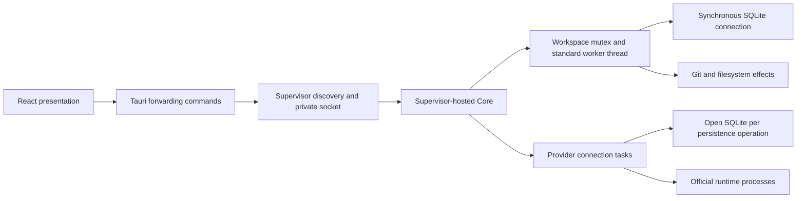
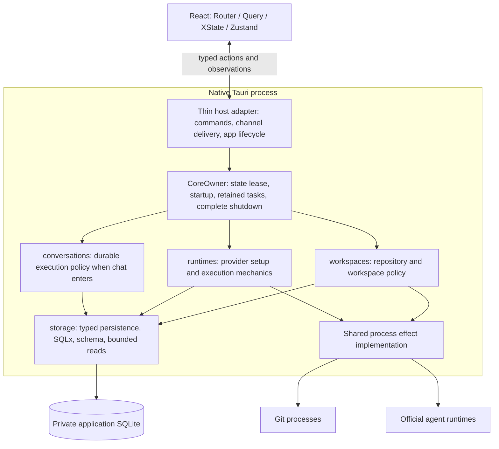
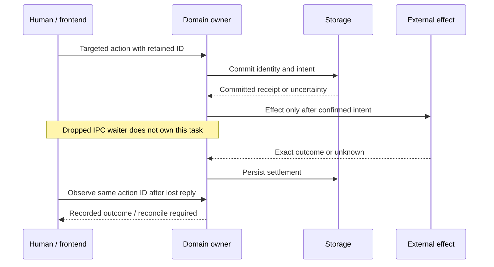
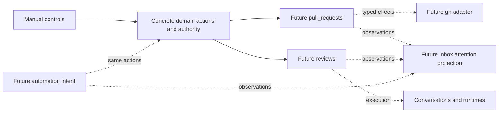

# Architecture and refactoring plan

2026-11-16 · Planning artifact for a later spec-and-ticket session. No implementation or qualification is claimed by this document.

[Visual architecture report](architecture-report.html) · [Architecture skill](/Users/christopherbengtsson/.agents/skills/improve-codebase-architecture/SKILL.md)

## 1. Direction, decisions and evidence

### Settled in this session

| Decision | Result |
| --- | --- |
| Product baseline | Conductor's repository, workspace, worktree and concurrent-agent workflows. Treat its implementation as evidence to assess critically, rather than a design to copy wholesale. |
| Process architecture | Host the UI-independent Rust core in the native Tauri process. Retire the separate application supervisor. This replaces the earlier selection to preserve native-desktop-crash survival. |
| Lifetime | Work continues across navigation, hidden/minimized windows and WebView replacement while the native owner lives. Native failure restores durable history and interrupted/uncertain outcomes; uninterrupted execution through native failure is not promised. Explicit Quit stops owned work and completes persistence/cleanup before reporting success. |
| Storage | Use SQLx directly inside Rust. Do not expose authoritative SQL commands to the frontend or add the SQL plugin just to obtain SQLx's mechanisms. |
| Private opening | Accept owner-private canonical state and file/alias validation, with an explicit limitation against same-user path replacement racing validation. Exact preservation of SQLite's NOFOLLOW flag is no longer an adoption requirement. |
| Concurrency | No product cap on repository, workspace, conversation or agent counts; no milestone-wide one-active-conversation rule. Bound resources and coordinate actual conflicts. Demonstrate concurrent work in this milestone. |
| Future authority | After repository opt-in, agents may prepare reviews and local fixes within an explicit grant/budget. Human approval is the default for publication, push, CI rerun and merge. Those capabilities are future work. |
| Future GitHub mechanism | Prefer the installed GitHub CLI, including `gh api` where high-level commands are insufficient. Keep credentials CLI-owned. A direct HTTP client is not the default. |
| Compatibility | Fresh current-build state; no retired-format migrations, old readers, compatibility adapters or parallel implementations retained for compatibility. Preserve code/worktrees, provider credentials/history and historical evidence. |

Future incoming-review preparation, own-PR assistance, unified inbox and automation are committed directions. They constrain the seams described below; this refactor does not implement their screens, tables, integrations, schedulers or execution flows. Jira remains optional. Existing milestone chat/approval/resume work remains milestone work, with its concurrency acceptance amended as agreed here.

### Current architecture and concrete friction

The inspected checkout is `24390a1e7ba108ca88704fbf73deac92915d3ab6`, with pre-existing local documentation/ticket changes. Findings refer to that source cohort, not a newly reproduced runtime failure.



| Friction | Source evidence | Consequence and deletion test |
| --- | --- | --- |
| A second application lifetime | `crates/core/src/connection.rs`, `supervisor.rs`, supervisor binary and staging scripts | Removing the standalone host really deletes socket discovery/start/reconnect, peer-version negotiation and sidecar staging. It does not delete core authority, state exclusion or provider cleanup. |
| Incomplete whole-core shutdown | Supervisor main releases its owner at line 93; connection finish at `connection.rs:1158` handles transport/providers; workspace joining occurs in `Workspaces::drop` at `workspaces.rs:632` | Owner release can precede workspace physical completion. Replace the success path with an explicit whole-core completion barrier. This is a source-ordering finding, not a newly executed race. |
| Storage inside the workspace state mutex | `OwnerState` at `workspaces.rs:319`; request paths around lines 569–601 | Changing synchronous calls into awaits under the same state lock would preserve contention and introduce unsafe lifetime/race reasoning. Separate mutable state from awaited storage work. |
| Repeated connection/dispatch mechanics | Provider stores in `storage.rs:17–96`; login persistence around `login.rs:349`; selection around `selection.rs:98` | Share one storage lifetime and await it directly. Delete database-only blocking dispatch and connection-per-operation code. |
| Worker and process polling | Workspace worker around `workspaces.rs:524`; Git nonblocking pipe loop around `git.rs:130–279` | Tokio tasks, asynchronous pipes and maintained channels can replace hand-driven wake/poll/thread mechanics. Keep policy, deadlines and bounded draining. |
| Lost result can lose useful failure evidence | `connection/tasks.rs` sends results with `let _ = send.send(...)` | Retaining physical work alone is insufficient. Domain outcomes/failures must settle independently of the request receiver. |
| Storage recovery escapes its injected seam | `OwnerState::store` at `workspaces.rs:357` opens concrete SQLite directly | Move connection replacement behind the storage owner; let the domain decide whether retry is authorized using substituted factual outcomes. |
| Retired-format branches remain | `storage.rs` schema versions 1→2→3; `Workspace.legacy` in `creation.rs:85` | Their deletion removes compatibility complexity under the accepted development policy. Current-build integrity and recovery remain. |

Useful depth already exists in workspace identity, atomic registration/first-creation continuation, immutable reservations, exact provider targeting and inspection comparisons. Preserve those behaviors and their useful tests, without preserving their present containers. Deleting their owning modules would redistribute real decisions among callers; they earn their keep.

### Evidence categories and limits

- **Shipped-code observation:** `/Applications/Conductor.app` is build 0.93.0. Its native executable SHA-256 was rechecked as `062937acd521353151df361604d08af8d16b6ba687b6a6e74c67ff8a1e6d05e4`. Retained bundle evidence shows SQL-plugin load/select/execute, WAL configuration and frontend-to-sidecar RPC. Native symbol names include sidecar connection and cached-broadcast replay machinery. These do not establish standalone execution/storage ownership or native-crash survival.
- **Additional static dependency evidence:** source-path labels in the executable include SQLx 0.8.6, SQL plugin 2.4.0, Tokio 1.52.3, Tokio-util 0.7.18, tracing 0.1.44, tracing-subscriber 0.3.23, notify 7.0.0/8.2.0, notify-debouncer-full 0.5.0, portable-pty 0.9.0, nix 0.28/0.29/0.30.1 and several Tauri plugins. A label establishes embedded version evidence, not direct dependency ownership, exact use or an unmodified upstream build. A textual `p-limit` match was a diagram shape label, not scheduling-library evidence.
- **Upstream documentation:** Conductor documents independent workspaces and collaborative chats sharing one workspace. No numeric local concurrency cap was found in the official pages reviewed; that does not establish unlimited capacity. Its FAQ says local sessions end when the app closes, and its changelog describes hidden/minimized operation. Neither establishes native-crash behavior. [Parallel work](https://www.conductor.build/docs/concepts/parallel-agents), [local lifetime](https://www.conductor.build/docs/cloud/faq), [hidden/minimized operation](https://www.conductor.build/changelog/0.92.0-remote-control).
- **Architecture inference:** a Tauri-hosted Rust core with direct SQLx meets the selected local lifetime with less application-owned coordination. This is our recommendation, not a recovered Conductor design.
- **Actual qualification:** none performed in this session. Prior storage benchmarks used disposable harnesses, not the production core. They do not select a performance winner, qualify cancellation after arbitrary owner failure, or justify dropping admitted output. Preserve [the original evidence](../../docs/evidence/storage-async-comparison/README.md) and its failed/unperformed checks.

Conductor was not launched. No Conductor databases, credentials or user history were inspected. RAT was not inspected. No providers or authentication flows were run.

## 2. Recommended architecture and guarantees

### 2.1 Process ownership and module shape



Use concrete domain handles plus one host-independent `CoreOwner`. A handle hides coordination; it is not one forwarding module per command. Core construction takes a state lease, concrete effect adapters and the host's execution context. The core depends on Tokio, not Tauri. Tauri uses its existing singleton Tokio runtime; the core constructs no runtime and performs no per-operation `block_on`. [Tauri 2.12.5 runtime source](https://raw.githubusercontent.com/tauri-apps/tauri/tauri-v2.12.5/crates/tauri/src/async_runtime.rs).

The intended interface shape is:

```rust
// Shape to carry into the spec; exact names are not a wire-format commitment.
CoreOwner::open(state_lease, dependencies).await -> (CoreOwner, CoreHandles)
CoreOwner::shutdown().await -> ShutdownReport

Workspaces::register(targeted_registration).await -> ActionReceipt
Workspaces::create(targeted_creation).await -> ActionReceipt
Workspaces::action(action_id).await -> ActionObservation
Workspaces::observe(query).await -> BoundedObservation
// Provider and later conversation handles expose their own concrete actions.
```

Use public typed async methods and private owner tasks only where serialized mutable policy or continuing execution warrants them. Do not make every read a mailbox message or route all core work through one giant command enum. Native command enums remain useful wire contracts; they need not be the core's internal programming model. Dependency seams remain specific and usually internal.

| Module | Owns | Interface hides |
| --- | --- | --- |
| Native host adapter | One initialization, Tauri commands/channel subscriptions, window/quit events | Framework objects and delivery plumbing; no domain retries or second storage owner |
| `CoreOwner` | State lease, core incarnation, startup/recovery phase, admission fence and ordered shutdown | Whole-core lifetime; it composes concrete owners without taking over their recovery decisions |
| `workspaces` | Repository identity/location, workspace branch/worktree, pinned base, creation/setup/archive policy and workspace-wide admission | Reservations, Git reconciliation and targeted conflicts |
| `conversations` at chat implementation | Application/native conversation mapping, turns, sends, exact approvals, resume and durable output positions | Provider receipt uncertainty and execution decisions |
| `runtimes` | Provider readiness/login, captured executable/configuration, protocol/process mechanics and cleanup evidence | Provider-specific contracts and credential-scope exclusion |
| `storage` | Current schema, SQLx lifetime, atomic typed writes, committed reads and bounded payload access | SQL, pools, transaction cleanup, connection validation and configuration |
| Shared process implementation | Launch, bounded async I/O, waits and owned-group mechanics for finite commands/runtime adapters | Repeated OS mechanics; domain command construction and retry choices stay with their callers |
| Feature observations | Decode/context validation, freshness and presentation interests | Query keys, delivery details and physical read coalescing |

Dropping a WebView, handle or IPC waiter releases interest, not execution ownership. Status reads observe startup instead of creating competing cores. A core incarnation replaces the old supervisor-owner identity in replies, feed cursors, pending actions and Query scopes; it is an epoch, not a PID or a new permanent domain identity.

### 2.2 Repository/workspace identity and concurrent work

Retain a durable repository ID keyed by canonical shared Git directory. Main checkout and linked worktrees share one registration; independent clones remain distinct. A registered location is evidence about availability, not the identity itself. Missing or changed locations stay visible; no silent reassociation by remote URL.

Each workspace has its own stable ID, repository membership, reserved managed location, branch and pinned base. Names are human labels. A provider belongs to a conversation, never to workspace identity. Keep registration and first-workspace creation as separate actions, with the continuation atomically saved with successful registration. Creation still does not launch an agent.

Independent work gets independent workspaces by default. Deliberate collaboration may share a workspace, including implementation plus review or test repair. For future unattended PR jobs, default to separate managed workspaces; reusing an actively edited workspace requires explicit selection and comparison validation. This is a recommendation adopted from the user's tentative preference and the documented workflow, rather than a claimed requirement that every reviewer must use a separate checkout. [Conductor](https://www.conductor.build/docs/concepts/parallel-agents), [OpenAI worktrees](https://learn.chatgpt.com/docs/environments/git-worktrees), [Anthropic worktrees](https://code.claude.com/docs/en/worktrees).

Coordinate by the resource actually shared:

- Serialize conflicting common-Git-directory branch/worktree mutations within a repository; independent repositories can progress concurrently.
- Fence destructive workspace lifecycle operations against every affected conversation/process. Do not use one global active-workspace sentinel as execution authority.
- Exclude duplicate ownership of the same native provider conversation. A provider process may host multiple conversations if its supported contract permits it.
- Allow independent conversations in one workspace; make overlapping edits visible. Application leases cannot prevent an external terminal or unrestricted agent from editing files. Revalidate branch, worktree and comparison evidence around Git effects.
- Treat Git's own locks/errors as external evidence and reconcile partial worktree effects. Never delete unrelated branches/folders to make a retry succeed.

Archive/restore keeps its existing product guarantees: fence activity, confirm owned stop, save code including uncommitted changes, persist the archive result, and only then perform allowed cleanup. Failed snapshots or uncertain cleanup retain original work. This refactor supplies the lifetime seam; it does not implement deferred archive features.

### 2.3 SQLx, transactions, history and attachments

Use SQLx 0.9.0 as the assessed cohort, with defaults disabled and the SQLite/Tokio features selected. Pin the final compatible dependency graph at implementation. The repository's Rust requirement accommodates SQLx's Rust 1.94 minimum. Remove production rusqlite in the same driver cutover: the assessed libsqlite3-sys ranges cannot coexist unchanged in one graph. This is a dependency-resolution gate, not a reason for dual drivers. [SQLx manifest](https://raw.githubusercontent.com/transact-rs/sqlx/v0.9.0/Cargo.toml), [SQLite driver manifest](https://raw.githubusercontent.com/transact-rs/sqlx/v0.9.0/sqlx-sqlite/Cargo.toml).

Start with one storage owner containing a SQLx writer pool capped at one connection and a separately bounded reader pool capped at two. These are internal resource settings, not repository/agent limits. SQLx owns connection reuse, acquisition, worker execution and transaction-drop mechanics. Use ordinary bound runtime queries initially; optional query macros and their offline-metadata preparation are deferred until their benefit justifies that additional gate. Use one current-schema initializer and exact schema version acceptance, not a migration ladder.

Initial storage settings: WAL, FULL synchronization, macOS fullfsync, foreign keys, 100 ms busy timeout and the ordinary 1,000-page automatic checkpoint threshold. Verify effective values on every new connection. Disable speculative periodic connection churn; replace unhealthy handles through the library after fencing their uncertain work. A busy timeout is not an action deadline and an automatic checkpoint threshold is not a WAL-size bound. SQLx uses a blocking SQLite worker per connection; async callers do not make disk operations intrinsically asynchronous. [SQLx connection](https://raw.githubusercontent.com/transact-rs/sqlx/v0.9.0/sqlx-sqlite/src/connection/mod.rs).

Domain interfaces expose atomic operations such as recording registration plus its first-creation intent. They do not expose a pool, arbitrary SQL, a transaction or a closure scheduler. The domain validates the transition; storage commits its related records together. Keep uniqueness/foreign-key constraints for identities and reservations. Bounded opaque evidence can remain JSON; no universal entity store or speculative future schema is needed.

Ordering and failure rules:

1. Obtain bounded admission and serialize the whole conflicting domain decision, including duplicate action/payload matching and shared pending capacity.
2. Commit action identity, exact targets and intent before starting the external effect.
3. Perform Git/provider effects outside a database transaction and without a synchronous state lock.
4. Persist factual outcome or explicit uncertainty before reporting durable completion. Publish hints only after the corresponding committed state is available; volatile progress is labeled as such.
5. A repeated action ID retrieves its existing action; a changed payload under that ID is rejected. A lost reply authorizes observation/reconciliation, not a new effect.
6. A reconciliation read waits for the corresponding admitted writer operation to settle, then starts a fresh read snapshot. An older reader seeing absence is not proof of non-admission.
7. A failed/unacknowledged COMMIT does not prove rollback. Keep cleanup/settlement owned; explicitly roll back when possible or retire/fence the affected connection. Do not reuse it while transaction state is unresolved. Preserve the original failure even if later closure succeeds. [SQLite transaction contract](https://www.sqlite.org/lang_transaction.html), [SQLx worker](https://raw.githubusercontent.com/transact-rs/sqlx/v0.9.0/sqlx-sqlite/src/connection/worker.rs).

For internally consistent multi-query context, use one short read transaction on one acquired connection. Include the committed position/revision in the result. Release it before awaiting agents, network calls or human input. Keyset-page histories; bound rows and bytes and distinguish unavailable/oversized content from an apparently empty history.

At durable-chat implementation, store transcript events in the same authoritative SQLite database as turn/action metadata, with an indexed per-conversation durable position. Commit the position with the event batch. Keep presented output, provider receipt, durable transcript position and invalidation-feed cursor distinct. Durable history remains readable if native provider history disappears.

At first attachment implementation, prefer bounded database content with metadata, separate content reads and no attachment bytes embedded in every history page. This reduces multi-store publication/recovery infrastructure. Do not build attachment tables before the feature. Large-file/external-blob storage waits for an actual payload requirement. If selected later, require private staging, complete write/sync, immutable publication, then database-reference commit, with explicit orphan/incomplete-file recovery. A SQLite transaction cannot include Git, providers or ordinary files. [Retained storage assessment](../../docs/research/milestone-01-storage-evaluation.md#history-attachments-backup-and-disposable-caches).

Keep checkpoint work bounded and observed: duration, busy/incomplete result, frame counts and WAL growth. Short readers and stalled-reader cancellation/release come before special checkpoint infrastructure. Do not unlink WAL/SHM for cleanup or require truncation after every operation. Checkpoint/close cannot establish power-loss qualification. Use a consistent SQLite operation for any later backup; copying just the live database file is not the backup plan. [SQLite WAL](https://www.sqlite.org/wal.html).

Private opening keeps a validated canonical owner-only directory, private regular single-link metadata files and private creation permissions. Preflight the database/journal/WAL/SHM and use supported pool hooks for validation/configuration on connection establishment/reuse. Those hooks run after native opening; they do not restore atomic NOFOLLOW. The accepted contract excludes same-user replacement races and claims no equivalent flag. Keep the native NOFOLLOW flag for application-created lock/files where available; no custom SQLite VFS, raw-handle adoption or fork. Avoid changing process-wide umask after Tauri threads exist. [SQLx opening source](https://raw.githubusercontent.com/transact-rs/sqlx/v0.9.0/sqlx-sqlite/src/connection/establish.rs).

### 2.4 Admission, fairness, memory and physical completion

Resource bounds are implementation safeguards, not fixed product cardinalities. Repository/history growth is paged and disk-pressure failures are visible. No schema or action rule limits users to one running agent or a fixed count of worktrees.

Use maintained semaphores and bounded channels. Acquire capacity before task creation, queueing or blocking submission. Account for queued payloads, in-flight buffers, decode/materialization, batch copies and undelivered results separately. Keep permits with their actual allocation/effect lifetimes. A frontend cancellation or request timeout cannot release physical capacity early.

Starting refactor budgets, to record and qualify rather than advertise as capacities:

| Resource | Initial internal default | Full/closed behavior |
| --- | --- | --- |
| Ordinary native effect requests | 64 outstanding, 64 KiB each, 4 MiB aggregate retained command payload | Reject before transfer with structured busy/not-admitted evidence; no unbounded semaphore waiters |
| Control/status interests | Separate reserve of 8 bounded requests; stop tokens have a direct coalescing path | Cleanup/status remain available while ordinary work is full; repeated identical control interest coalesces |
| Finite Git/filesystem dispatch | 8 ordinary physical operations; 2 reserved cleanup operations | Queue only within admitted interests; no unbounded `spawn_blocking` submissions |
| SQL connections | 1 writer + 2 readers; 1 s pool-acquisition timeout | Acquisition failure is explicit; failure after dispatch is not declared non-admission without evidence |
| Metadata observations | 32 rows / 48 KiB per page; at most 8 retained native read interests | Page or return a typed limit result; never materialize an unbounded collection |
| Invalidation delivery | Existing 256-entry journal, 32 tags / 4 KiB per batch, one unacknowledged batch per subscription | Coalesce/gap to resync; no unbounded WebView delivery queue |

These defaults bound request/effect work, not the lifetime or number of running conversations. Long-lived conversation execution retains small accountable identity/state plus globally budgeted streaming buffers; it does not hold an ordinary request slot for the whole turn. Child runtime resource use is external to the app's buffer accounting and must be measured/reported separately. Resource exhaustion produces explicit feedback, not an invented product entitlement limit. Tune defaults only with affected qualification, without changing identity/schema.

For streamed chat, use a private bounded writer policy that groups events by count, bytes and elapsed time, with per-workspace fairness and reserved urgent intent/control progress. Begin with 64 events / 256 KiB / 25 ms per eligible batch, a 16 MiB global admitted-output budget and a 4 MiB per-workspace share under contention. Permit borrowing unused share; do not reserve memory for every historical workspace. The measured 64-event diagnostic motivates a starting count, not a throughput claim. Fair dispatch is byte-aware round robin across ready workspaces, with at most one ordinary batch before rechecking urgent intent/control; prevent endless urgent traffic from starving admitted durable output. Keep this scheduler private to actual streamed persistence, not a generic workflow engine.

Provider output already admitted to execution receives bounded backpressure. If the supported protocol cannot safely pause/drain, expose a capacity failure, request stop and retain the durable prefix and explicit gap/uncertainty. Never drop durable chunks silently. Bound single frames/items and decode copies; an oversized durable item fails visibly rather than being truncated into apparently complete history. Final event/frame limits must follow the supported provider/schema and the concrete chat payload scope; attachment limits belong to that later feature, not this foundation.

Use `JoinSet` for owned operation outcomes/panics and reap continuously. A small identity association permits panic attribution; it contains no duplicate observation bodies. Retain result/error settlement independently of oneshot reply delivery. Compact recoverable outcomes live in domain records; large result bodies are reclaimed within the read budget. If failure settlement cannot be persisted, keep the core fenced and expose a volatile storage fault. Do not accumulate finished task results indefinitely. [JoinSet source](https://raw.githubusercontent.com/tokio-rs/tokio/tokio-1.54.1/tokio/src/task/join_set.rs).

Synchronous state locks are short and never cross awaits. An explicit Tokio operation gate may span a storage await when it serializes one entire admission decision; document that scope and avoid holding it across Git/provider execution. Long effects operate on captured identities/generations; revalidate them on completion. Per-key gates remain retained until conflicting work settles, so removing an idle-looking map entry cannot create a second gate for the same resource.

Cancellation tokens request cooperative stop; they do not prove process termination or write rollback. Do not abort admitted durability/cleanup tasks on view disposal, use a `JoinSet` abort-all operation as graceful shutdown, or race a write against a timeout and infer non-delivery. A task panic fences its affected owner, settles/retire its resource and retains uncertainty before replacement. A native-process crash falls under durable recovery, not successful in-process draining.

### 2.5 Startup, recovery, shutdown and development reset

Startup is one native-owned sequence: resolve/validate state → acquire its file lease → open/initialize storage → restore durable actions → reconcile or fence uncertain work → construct domain handles → expose ready observations. Startup does not send a turn or run a future workflow merely because a view mounted. Expose `starting`, `recovering`, `ready`, `fenced/failed`, `stopping` and `stopped` as distinguishable phases. Partial initialization cleans every successfully acquired resource before releasing the lease, collecting failures without skipping remaining cleanup.

WebView reload attaches to the same core incarnation, reads authoritative status and catches up. Native restart creates a new incarnation and reads the durable prefix. Pending Git effects reconcile their recorded branch/path; pending provider sends/resume/login reconcile exact provider evidence. Saved PIDs alone never authorize signaling. Uncertain surviving runtime work fences conflicting execution until authoritative evidence or an explicit recovery action resolves it. This is particularly important because native failure can leave child processes alive; neither Tokio drop cleanup nor a process group is automatic macOS parent-death containment.



Explicit Quit is idempotent and has one retained completion owner:

1. Fence new effectful admissions across all domains; keep status/stop/reconciliation observations available.
2. Stop producers and request exact conversation/runtime cleanup; account for every affected workspace and child operation.
3. Join domain tasks and actual blocking/process work; complete final persistence while storage is still accepting these owned writes.
4. Fence storage, settle admitted writes/reads and retained failures, observe checkpoint results, then await both pool closures.
5. Stop/join feed delivery and release native host resources. Release the state lease last, then permit Tauri exit.

`Pool::close().await` returns `()`, waits for checked-out connections and closes the pool; it is not a returned per-connection error audit or literal OS-thread join. Preserve all preceding operation/rollback/checkpoint errors, use explicit fallible connection cleanup where applicable, and report exactly the guarantees observed. A pool-close acknowledgment cannot erase a failed action. [Pool close source](https://raw.githubusercontent.com/transact-rs/sqlx/v0.9.0/sqlx-core/src/pool/mod.rs).

A deadline reports pending/failed cleanup and leaves the owner active with continuing completion handles. It never fabricates success, discards the remaining task set, or permits a replacement owner. Repeating Quit observes/reconciles the same shutdown. Native force-kill is a failure/recovery event, not a successful Quit. Audit the development launcher's three-second escalation because killing Tauri now kills the core host.

Development cutover/reset procedure, for later execution only:

- Inventory the exact old/new state directories and managed worktree roots. Stop the old owner through its matching build and confirm physical cleanup/lease release. Do not signal from a stale PID or delete/recreate `owner.lock`.
- Retain the socket-free state lease using the same lock filename/inode when opening the same root, so a still-live old supervisor blocks new ownership before any storage open. An OS lock is retained even though the single-instance desktop UX may be separate.
- Select a fresh private metadata namespace for the new current build and record its exact schema/configuration. Keep old database/WAL/SHM as an untouched closed set. Do not rename/delete an entire state root that contains existing worktrees.
- Preserve original checkouts, all existing managed worktrees/branches, runtime homes, credentials, native histories and evidence. Old development metadata is not imported; explain that old history remains available through the retained old build/state, not through a compatibility reader.
- New fresh-state registrations may inspect the same local codebase, but they must not take over, remove or reuse old managed worktree locations. Re-register deliberately, create fresh managed locations and keep explicit cleanup/import workflows separate.
- Reject incompatible current-schema state with actionable fresh-state/restart guidance. Never silently initialize over an old database or automatically erase it. An explicit override remains an exact chosen root; development defaults no longer depend on a supervisor binary/protocol hash.

Screensaver, lock and display sleep are distinct from system sleep. A local supervisor cannot run work through system sleep. A future opt-in keep-awake policy can use the platform assertion/system utility while active work owns it, allow display sleep and release it on completion/cleanup. Lid/manual/low-battery sleep remains possible. Keep this separate from process placement and outside this refactor's feature scope. [Apple contract](https://developer.apple.com/documentation/iokit/kiopmassertiontypepreventuseridlesystemsleep).

### 2.6 Frontend observations and actionable failures

Keep Router as navigation authority, Query as the sole validated observation cache, XState for real feed/inspection coordination and Zustand for allowlisted presentation memory. Retain the existing feature interfaces and physical request coalescing. UI unmount releases an interest rather than core execution. No new global frontend domain store, SQL facade or second action-retry owner is introduced.

Bound inactive Query observation bodies by 128 pages or 16 MiB of serialized payload, whichever is reached first, using Query's inactive-entry removal mechanisms. Active bodies remain bounded by view/read interests and page limits; pending action interests retain identities rather than duplicate bodies. Serialized size is an accounting measure, not an exact JavaScript heap guarantee: measure actual heap/retention during qualification. Keep bounded presentation-memory eviction separate from durable workspace/history identity; evicting a cached page never deletes saved work.

Replace socket-backed delivery with an app-scoped native Tauri-channel adapter. Keep bounded hints, incarnation/subscription identities, gap/resync behavior and acceptance-before-acknowledgment. A new WebView can resync after missed hints. Stop/join old native subscriptions before replacement; listeners and setup promises outlive transient views until settlement. The journal remains a volatile invalidation mechanism, not durable history.

Regenerate Rust-owned declarations/validators and change contextual checks to the core incarnation. Preserve exact target/membership/revision validation and safe byte/integer bounds. Remove peer protocol negotiation rather than maintaining both wire versions. Tauri IPC can still lose a reply, so the UI retains action IDs and observes outcomes after uncertainty.

Surface failures as an exact action/target, observed state, last durable point, reason and safe next action. Preserve last-good observations as stale. Distinguish a read failure, rejected admission, failed effect, unknown effect and pending cleanup. Supervisor connection diagnostics become application startup/storage/runtime diagnostics; repository unavailability and provider readiness remain separate concepts.

Add structured tracing for incarnation/action/workspace/conversation/task identities, duration, queue pressure, commit latency, outstanding work and shutdown phases. Exclude credentials, auth URLs, transcript bodies and full environment dumps. Diagnostics supplement authoritative state; log output is not the only record of an actionable failure.

## 3. Alternatives, maintained mechanisms and future seams

### Process and storage alternatives

| Alternative | Benefits | Costs / decision |
| --- | --- | --- |
| **Tauri-hosted core + direct Rust SQLx** | Deletes a separate application host and transport; same Rust domain decisions for manual and future agent callers; direct control of transactions/pool configuration | **Selected.** Native failure interrupts or makes execution uncertain; durable recovery and owned child cleanup still require qualification. |
| Separate supervisor + direct SQLx | Admitted work can survive native desktop failure; natural host for independent clients | Reject for this milestone's selected lifetime: discovery, IPC, access/version coordination, packaging and two lifetimes do not earn their cost. Revisit only for a concrete independent-host requirement. |
| Separate supervisor + frontend SQL plugin | Convenient frontend SQL calls | Conflicts with sole supervisor storage ownership. Opening the same SQLite file twice is not one logical authority; proxying storage through desktop reverses the desired dependency. No split owner. |
| Tauri SQL plugin as authoritative frontend persistence | Maintained SQLx backing, convenient CRUD and shipped Conductor precedent | Plausible for simpler local CRUD. Here it spreads multi-step authority/persistence/effect ordering across callers. Stock commands do not expose a transaction handle binding separate calls to one connection. Reject for authoritative domain writes. |
| SQL plugin plus Rust access to its managed pool | Can technically share a SQLx pool in one process | Adds plugin-managed opening/configuration/exit order while Rust still needs domain transactions and physical completion. Less leverage than using SQLx directly. No separate cache database/plugin is added speculatively. |
| Retained rusqlite bridge | Previous evidence supports comparable harness behavior and exact opening flags | User has selected SQLx and accepted a narrower opening contract. No generic benchmark contest is reopened; retained experiments remain evidence. |

The plugin and SQLx are distinct mechanisms: the former supplies Tauri-managed database commands/state; the latter supplies the actual Rust pool, connection and transaction implementation. Direct SQLx is not a custom replacement for a maintained pool. [Plugin documentation](https://v2.tauri.app/plugin/sql/), [tagged command implementation](https://raw.githubusercontent.com/tauri-apps/plugins-workspace/sql-v2.4.0/plugins/sql/src/commands.rs), [managed pool and exit implementation](https://raw.githubusercontent.com/tauri-apps/plugins-workspace/sql-v2.4.0/plugins/sql/src/lib.rs).

### Module shapes evaluated with independent design exploration

| Shape | Depth, locality and seam tradeoff | Decision |
| --- | --- | --- |
| One `command / observe / finish` core interface | High host leverage, but giant command/result enums expand with every feature and can obscure domain locality | Keep a small lifetime interface, not a universal internal dispatcher. |
| Concrete domain handles + one lifetime owner | Narrow domain types, local recovery policy and clear composition; cross-domain admission needs explicit ordering | **Selected.** Private effect/test seams supply substitution without exposing infrastructure. |
| An actor/mailbox for every module | Structural mutable-state ownership and bounded messages | Use only where continuing serialized work earns the extra task/reply lifecycle. Ordinary consistent reads and small async operations can remain direct. |

The interface is the test surface, including its ordering and failure guarantees. Repository policy also permits private seams: preserve them where they let tests substitute storage/Git/process outcomes without testing through a whole app. Production plus scenario-specific test adapters justify these seams; a single production driver does not invalidate them.

### Maintained-mechanism assessment

This is an adoption decision inventory, not a list of every dependency found in Conductor.

| Mechanism / assessed cohort | Recommendation | Custom code removed or retained |
| --- | --- | --- |
| SQLx 0.9.0, SQLite/Tokio | **Adopt for storage** | Remove per-call connections, database-only blocking wrappers and homegrown driver/reader acquisition machinery. Retain typed transactions, budgets and uncertainty policy. |
| Existing Tokio 1.54.1 + Tokio-util 0.7.20 | **Use throughout ownership/I/O** | Replace workspace wake thread and Git pipe polling with bounded channels, async I/O, semaphores, `JoinSet` and `CancellationToken`; retain exact effect identities and stop/reconciliation choices. |
| `JoinSet` versus `TaskTracker` | **Choose JoinSet for operation outcomes** | Continuously consume outcomes/panics. TaskTracker is useful for completion-only work, but does not retain return values and its `close()` does not fence spawning. Avoid an extra result registry just to use both everywhere. [Tagged comparison](https://raw.githubusercontent.com/tokio-rs/tokio/tokio-util-0.7.20/tokio-util/src/task/task_tracker.rs). |
| `tokio::process` and standard process-group support | **Use as process mechanism** | Delete manual nonblocking pipe flags/read-sleep loops where async pipes replace them. Preserve one deep owned-process implementation for bounded output, escalation, unreaped identity and cleanup evidence. [Tagged source](https://raw.githubusercontent.com/tokio-rs/tokio/tokio-1.54.1/tokio/src/process/mod.rs). |
| `process-wrap` 8.2.2; `command-group` 5.0.1 | **Do not add as a cleanup replacement** | Published process-wrap source waits/reaps the leader then uses group wait/ECHILD; that is not the current macOS quiescence guarantee. Kill-on-drop does not establish native-crash descendant cleanup. `command-group` is superseded by process-wrap. Reconsider for a concrete portability gain, not package count. [Published archive](https://static.crates.io/crates/process-wrap/process-wrap-8.2.2.crate), [maintainer notice](https://github.com/watchexec/command-group). Current main advertised a different version; the assessment used the published 8.2.2 source. |
| Rust `File::try_lock` | **Retain standard mechanism** | Extract socket-free `StateLease`; delete socket binding/discovery, not file exclusion. No fs2/fs4 lock dependency is needed. |
| Official Tauri single-instance plugin 2.5.5 | **Defer optional second-launch UX** | Can focus an existing app, but does not replace a lock on the selected state directory and must respect isolated dev roots. No custom instance server is planned. [Official documentation](https://v2.tauri.app/plugin/single-instance/). |
| tracing 0.1.44 + tracing-subscriber 0.3.23 | **Adopt structured diagnostics with the refactor** | Replace scattered diagnostic printing; use maintained filtering/formatting. Retain redaction and authoritative domain fault records. A bespoke logging framework is unnecessary. [Subscriber documentation](https://docs.rs/tracing-subscriber/0.3.23/tracing_subscriber/). |
| thiserror 2.0.21 | **Use for new internal error/source plumbing** | Derive standard error implementations; map to stable typed presentation errors at the host seam. It does not choose recovery policy. Avoid unrelated wholesale error rewrites. [Documentation](https://docs.rs/thiserror/2.0.21/thiserror/). |
| notify 8.2.2 + notify-debouncer-full 0.7.0 | **Worth exploring at a measured observation need** | Maintained watchers/debouncing can replace filesystem polling, but events are hints with overflow/editor/platform caveats. Existing visible-interest polling is simple; do not add watchers merely because Conductor ships them. [Watcher](https://docs.rs/notify/8.2.2/notify/), [debouncer](https://docs.rs/notify-debouncer-full/0.7.0/notify_debouncer_full/). |
| which 8.0.6 | **Defer** | Replaces a small PATH search, not saved-selection precedence, GUI shell environment capture, neutral working directory or credential scope. Add only when it removes a meaningful portability implementation. [Documentation](https://docs.rs/which/8.0.6/which/). |
| tokio-graceful-shutdown 0.20.0 | **Do not add now** | It supplies subsystem nesting/error/timeout handling, but the app still needs ordered domain drain and non-abandonment after deadlines. Existing Tokio mechanisms plus one explicit owner are sufficient; avoid a second lifetime framework. [Maintainer documentation](https://github.com/Finomnis/tokio-graceful-shutdown). |
| Apalis / tokio-cron-scheduler | **Evaluate when automation is implemented** | Maintained scheduling/job execution deserves assessment before writing a scheduler. No scheduler is needed for this refactor. Future evaluation must show compatible SQLite ownership, recoverable jobs and no blind retry of uncertain external effects. No framework/schema is preinstalled. [Apalis](https://docs.rs/apalis/1.2.0/apalis/), [scheduler project](https://github.com/mvniekerk/tokio-cron-scheduler). |
| Git CLI; future GitHub CLI | **Keep Git; prefer gh later** | Keep actual Git semantics rather than introducing git2/gix for speculative speed. gh avoids bespoke auth/HTTP plumbing; use structured output and `gh api` as needed. Publication uncertainty still belongs to Rust. [gh API command](https://cli.github.com/manual/gh_api). |
| Existing Query / Router / XState / Zustand / p-queue / Rust contract generators | **Retain their distinct roles** | Delete supervisor transport, not useful validated caches, physical request lifetimes or generated contracts. No new frontend state/scheduling framework. |
| PTY/shell/window-state/notification plugins seen in Conductor | **Feature-driven later adoption** | A shipped dependency is not a reason to add terminal, notification or persistence scope now. Keep provider execution in Rust, with credentials runtime-owned. |

Actual SQLx adoption gates are a coherent single SQLite-linked graph, current-schema initialization, async domain conversion, qualified opening under the accepted contract, retained commit settlement and complete host shutdown. No custom VFS, driver fork, throughput victory or literal OS-thread join is required. Confirm the bundled SQLite engine includes the WAL-reset fix (3.51.3 or a fixed release/backport); record the actual engine, rather than assuming it from the SQLx version. [SQLite fix documentation](https://www.sqlite.org/wal.html#the_wal_reset_bug).

### Future domain seams: design rules, not implementation scope



- **`pull_requests`:** owns remote host/repository/PR identity, checks/feedback and remote-action reconciliation independently of local clones, workspaces and conversations. Local repository IDs must not masquerade as remote IDs. Use explicit host/repository targets with gh; never infer a publication destination only from the current directory/branch.
- **`reviews`:** owns preparation identity, immutable evidence context, findings, draft revisions, human edits/selections and publication intent. Bind results to exact head SHA, base SHA, effective comparison/merge-base and captured diff identity. Local dirty comparisons need content evidence, not branch names alone. Changed revisions mark results stale; retain human edits and require revalidation rather than silently rebasing comment locations. Agent preparation writes a separate draft generation and cannot overwrite the human-edited draft.
- **Review independence:** a review uses explicitly supplied requirements, exact changes, repository guidance, checks and selected prior findings. A new tab or process alone does not establish fresh context. Qualify the concrete provider path; do not require full implementation-transcript inheritance. A result is useful without a permanently visible chat.
- **`automation`:** owns opted-in trigger/rule intent and concrete job progression when introduced. Persist source-event identity/generation, rule/context revision and target revision before execution. Atomically record a parent's completion and intended child action when chaining is introduced. Repeated event delivery retrieves the same logical preparation; a new head or review-request generation is distinct. Do not build a universal graph engine or shared mutable coordinator-context table now.
- **External effects:** local deduplication is not exactly-once GitHub execution. Record an effect intent before gh execution, retain returned remote identity and reconcile a timeout/lost reply using remote evidence before retry. A CLI exit status alone may not settle every partial effect. If evidence cannot distinguish absence from an unobserved write, remain uncertain and require resolution. Expected revision checks are used where the remote operation supports them; never claim all writes atomically test both head and base.
- **Authority:** manual and agent callers use the same Rust action semantics. Track initiator separately from the authority grant. Bind approval to exact action, target revision, draft version and effect scope; plan approval, runtime tool approval and remote publication approval are distinct. Changed payload/revision invalidates approval. Automatic preparation never grants publication authority.
- **Tool access:** a future unattended local-preparation grant must also fit the provider's actual shell/MCP/network permissions. An agent with unrestricted tools/credentials can bypass an application button's checks. Qualify maintained provider permission mechanisms; where they cannot enforce the promised remote-effect restriction, block unattended execution or require tool approval. Do not build a new sandbox speculatively or claim worktrees are a security sandbox.
- **Budgets and stop controls:** concrete grants later select repository, operation kinds, model/effort, time/usage and repeat limits. Distinguish measured usage from a hard billing cap. Pause future dispatch separately from stopping an active turn/runtime; cancel pending intent separately from resolving uncertain effects. No automatic larger-model fallback or unlimited retry chain.
- **Inbox/attention:** a future inbox projects domain-owned work/failures/decisions. It owns presentation acknowledgment/snooze, not execution truth. Attention has an exact source/action identity and a safe next action: approval needed, review ready, stale result, failed check, capacity failure, lost authority, unknown effect or cleanup pending. Acknowledging a row cannot resolve an underlying operation. Retain last successful sync time; unavailable sync never looks like an empty inbox.
- **Scheduling/lifetime:** future automation initially runs while the native app is alive, including hidden windows. Due work and intent are durable; timers only wake an owner. Restart first reconciles in-flight effects, then considers safe unstarted work under its grant. Running while the app is quit, login startup, remote/cloud execution and independent clients require a later explicit host-lifetime decision. Jira adds its own adapter only if selected.

The seams are justified now by existing action identity, resource ownership, exact comparison and recovery requirements. Future feature schemas, polling cadence, detailed GitHub operations, workflow configuration UI, attachment size policy and scheduling framework remain decisions for their actual feature sessions.

## 4. Refactoring sequence and qualification gates

These are implementation stages for later specification, not published tickets. Each stage has one production implementation. Keeping the incumbent host until its cutover is sequencing, not a compatibility adapter or permanent dual host.

| Stage | Change and dependencies | Reviewable completion gate |
| --- | --- | --- |
| **A — Publish the revised authority** | Later spec session records this plan's choices and amendments below before implementation. Establish source/evidence inventory, fresh-state procedure and old-to-new coverage map. | Conflicting ready-ticket instructions are explicitly superseded by the new spec; original results remain intact. No live-provider allowance is implied. |
| **B — One core lifetime and retained completion** | Add host-independent `CoreOwner`/socket-free state lease, whole-core admission fence and explicit shutdown. Consolidate operation ownership using existing Tokio mechanisms; keep domain decisions local. The incumbent host can exercise this seam before removal. | Units cover startup failure, request disappearance/panic, Quit races, actual blocking completion and lease-last ordering. Explicit completion replaces workspace `Drop::join` as the successful path. Status reports all core work, not provider-only shutdown. |
| **C — Shared async SQLx storage** | Depends on B. Centralize current schema/provider/workspace storage; remove rusqlite/retired migrations and database-only dispatch. Initialize on the continuously driven host runtime. Convert workspace admission/coordinator to async without lock-across-await regressions. Introduce structured diagnostics and bounded result settlement. | Substituted units plus fresh real-storage qualification pass atomic continuation/reservations, concurrent admission, commit uncertainty, settled-read ordering, pool saturation, opening/reopening, checkpoint pressure and complete close. No dual-driver fallback. |
| **D — Rehost and delete the supervisor** | Depends on C. Native Tauri initializes the same core once; switch commands/feed to direct handles/channel delivery. Rename incarnation/status contracts, regenerate declarations/validators and remove supervisor crate, discovery/socket/version paths, sidecar bundle/staging and obsolete tooling. Update dev launcher/state derivation. | One horizontal fixture-desktop slice covers startup, repository registration/first workspace, concurrent creation/inspection, provider setup/login fixtures, WebView replacement and owned Quit/restart. Package has no application-supervisor resource. Native crash shows durable recovery/uncertainty, not promised continuation. |
| **E — Qualify pressure and publish the chat handoff** | Depends on D. Complete concurrency/resource and recovery qualification for the existing foundation; record numeric defaults, coverage replacements and new host behavior. | Repository/workspace counts remain uncapped; multiple independent operations progress; control/status work under saturation. Static/build/package checks pass and failures/unperformed probes are recorded. Storage/lifecycle interfaces are documented for chat. |
| **F — Existing milestone chat and concurrent-work acceptance** | Consumes E and the qualified provider-connection handoff. Implement the milestone's durable chat/approvals/interrupt/resume work in its later sessions using these seams. Amend the old one-active-conversation policy. | Two active conversations share a workspace while another runs in another workspace; independent targeting/control, durable output/backpressure, history and restart recover correctly. These counts are a scenario, never product maxima. Complete fixture desktop first, then separately authorized native qualification. |

Do not fold PR/review/inbox/automation/Jira into B–F. Attachments, full archive/setup/fetch and other deferred MVP features retain their own scope decisions. The refactor does not close Milestone 01 merely because storage or the new host works.

### Verification cohorts

**Dependency-substituted application units:** use the repository's existing isolated unit entry point and controlled events/time. Substitute SQLite/filesystem/Git/process/provider outcomes, retaining real application policy, command construction and parsers. No real SQLite, repositories, sockets or provider/supervisor processes in application units; no new integration-test framework. Private owning-module seams remain valid. Map useful old assertions before deleting replaced orchestration/migration/transport tests.

Required scenarios include duplicate ID/same or changed payload; cross-kind/capacity admission; registration plus first-creation atomicity; immutable reservation recovery; two callers racing a state change; stale completion after an await; lost intent/commit acknowledgment; status read before writer settlement; canceled request while physical work continues; worker/owner panic; rollback/reopen failure; exact approval rejection; one noisy workspace alongside quiet work; result-retention exhaustion; startup/Quit races; failure of one cleanup stage without skipping others; owner release only after completion. Concurrency tests use controlled order rather than timing sleeps.

**Real storage and native-process qualification:** use fresh private disposable state and separate bounded harnesses/scripts. Exercise the selected actual SQLx graph/SQLite engine, effective PRAGMAs, validation on initial/replacement connections, regular-file/alias/permissions behavior, committed prefix across kill points, contended acquisition, real busy/commit cleanup, pinned readers/checkpoints, disk/full or injected I/O failure, orphan-output uncertainty, repeated startup/lease exclusion and native parent loss with owned subprocess fixtures. Retain failed/unperformed cases. Process-group success does not prove escaped-descendant termination. Process-crash results do not prove power-loss durability.

**Fixture desktop:** test the actual Tauri-hosted core, not only DOM mocks. Include multiple registered repositories/worktrees, concurrent workspace creation and inspection, provider setup/login fixture continuity, WebView reload, native crash/reopen, Quit during startup and activity, storage/cleanup failure presentation, saturation with usable controls, and current-build history when chat lands. Requalify source-dependent startup/owner guarantees rather than relabeling old supervisor evidence.

**Native provider:** agree exact scenarios, submissions, model/effort, limits and stop conditions separately. No allowance from earlier proof is reused. Qualify actual concurrent conversations, exact identity/routing, approvals, interrupt/cleanup, durable prefix and exact resume in the real desktop. Provider/runtime credentials/history remain external and preserved. Fixture success and source inspection cannot complete this cohort.

**Preparation/static/build/package:** keep generated-contract/route preparation, typechecking/linting, Rust compilation, isolated units, full verification and packaging identifiable. Inspect current scripts when implementing; update their supervisor assumptions. Use the existing `generated:check`, unit/static/build entry points as the baseline and replace `qualify:process`'s retired supervisor scenarios with separately named storage/native-lifecycle qualification. Do not remove all process qualification with the supervisor crate. Run one build/check at a time per worktree and preserve target ownership safeguards.

Measure navigation feedback against 100 ms and recent-history opening against one second on the test Mac under the representative concurrent scenario. Report stream/commit/control latency, accepted/failed/outstanding bytes/events, per-workspace progress, peak app buffers versus child-process RSS, acquisition wait, checkpoint/WAL behavior, build/bundle deltas and drain results. These are production-path acceptance observations, not another driver contest. Use the repository's warm-up/five-run measurement policy where timing claims are made; distinguish app qualification from isolated research.

## 5. Documentation amendments, risks and handoff

### Amend in the later spec/implementation sessions

| Document/policy | Required amendment |
| --- | --- |
| `docs/MVP.md` | Replace separate-supervisor hosting and native-desktop-crash continuation with Tauri-hosted core/local lifetime; retain Rust authority, current-build durability, process cleanup and future PR/review ownership. Record resource-based concurrency and deliberate shared workspaces. |
| `docs/MILESTONE-01.md` and milestone spec | Replace supervisor-specific startup/reconnect/A8/A10 acceptance, remove one-active-conversation admission/qualification, add the agreed concurrent scenario and new native-crash recovery acceptance. Preserve all completed cohorts as historical results. |
| Frontend-navigation spec and ADRs 0006/0007 | Explicitly supersede separate-process transport/owner requirements because that spec currently takes precedence. Retain Router/Query/Zustand, generated validation, XState coordination, Rust policy and physical completion. Update observation guidance and component documentation only where their actual contracts change. |
| ADRs 0003/0004/0005 | Retain shared Git identity, atomic first creation and readable immutable reservations. Supersede old schema-migration/legacy-format obligations in 0005; add concurrency/lifecycle clarifications only where needed. |
| New architecture ADR(s) | Record Tauri hosting + direct SQLx, the assessed plugin alternatives, private-state race limitation, real deletion and rejected extra frameworks. Do not rewrite earlier decision evidence to look as though this was always the architecture. |
| Storage selection research / 06b / 07 | New spec explicitly replaces the bridge recommendation and supervisor-based handoff. Mark old implementation instructions superseded through the tracker flow; preserve original experiments and provenance. Publish the actual SQLx/core handoff before dependent chat work. |
| Verification/observation/TanStack/tooling docs | Keep substituted units; update host/runtime ownership and qualifying commands, retired peer contracts, generated preparation and sidecar-specific policy applicability. Provider/other executable packaging still requires provenance when introduced. |
| `GLOSSARY.md` | Add core incarnation/state lease only if they become shared domain language; later add remote PR/review/automation/attention terms when those features are specified. No placeholder glossary expansion is required now. |

This session leaves all of those documents, existing tickets and historical evidence unchanged. The later `$ask-matt` session should consume this plan, resolve the existing precedence conflicts through a new authoritative spec and then create/revise the implementation task graph. This artifact is not that spec or task graph.

### Risks and deliberately deferred decisions

- **Native crash/orphans:** Tauri hosting gives up uninterrupted native-crash survival. Actual surviving provider/tool behavior needs qualification; uncertainty may block a workspace until resolved. No library inspected makes macOS process groups automatic parent-death containment.
- **Async conversion:** whole-decision serialization and stale-result revalidation must survive storage awaits. A pool underneath the old mutex does not satisfy this plan.
- **Private-state contract:** validation plus private ownership is weaker than atomic SQLite NOFOLLOW. Pool hooks occur after native opening. That limitation was explicitly accepted; record actual behavior without presenting it as equivalent protection.
- **SQLx shutdown/error evidence:** pool closure supplies a useful maintained barrier but no aggregate returned close error or literal OS-thread join. Define success from settled domain effects and documented library behavior; retain failures independently.
- **Resource tuning:** proposed budgets/batch settings are starting defaults and need production-path qualification. No unlimited-capacity claim follows from uncapped product cardinality. Neither earlier heavy harness accepted its entire offered workload under all settings.
- **Shared workspace edits:** leases coordinate app-owned operations; external tools and provider processes can still conflict. Exact comparison evidence and honest overlap feedback remain necessary.
- **Future authority:** unattended local fixes cannot promise remote-effect approval if a provider's unrestricted tool configuration bypasses it. Qualify permissions when the feature is selected.
- **Deferred product decisions:** automation rule configuration, precise usage/time grants, publication UX, scheduling framework, unattended-after-Quit hosting, Jira, large/external attachment thresholds, terminal/PTYs and cloud clients wait for concrete feature scope. They do not block this refactor.

No unresolved product decision blocks writing the refactor spec. Actual adoption/qualification gates remain work to perform, not claims made by this plan.

### Artifact and investigation record

The visual report contains before/after cards for core lifetime, shared async storage, concurrent workspace activity, maintained process effects and future attention/workflow seams, plus the alternative-shape comparison. A durable copy is linked above; the architecture skill's temporary report is `/var/folders/rz/kbp845ws6kl3hd237p2_4n7m0000gn/T/architecture-review-20261116T015550Z.html`.

Required local policies, MVP/milestone, glossary/ADRs, IDEAS, 06b/07 and the named storage/Conductor research/evidence were inspected. Intent discovery succeeded; the installed Router/Query composition guidance was loaded for observation planning. The architecture skill's fresh exploration and design-it-twice work used independent planning agents; no implementation was delegated. Library inspection used upstream documentation/tagged source and, where current documentation disagreed with the published cohort, the published crate source. No dependencies were installed, production tests/benchmarks run or application state reset.

Artifact validation checked local Markdown targets, six HTML candidate cards, eight inline SVG diagrams, unique HTML identities, the two intended CDN scripts and identical temporary/durable report copies. The temporary report was opened in the existing browser and visually checked at its opening card and closing Mermaid sequence/recommendation; typography was corrected after inspection. This is artifact QA, not application, storage, process or provider qualification.
