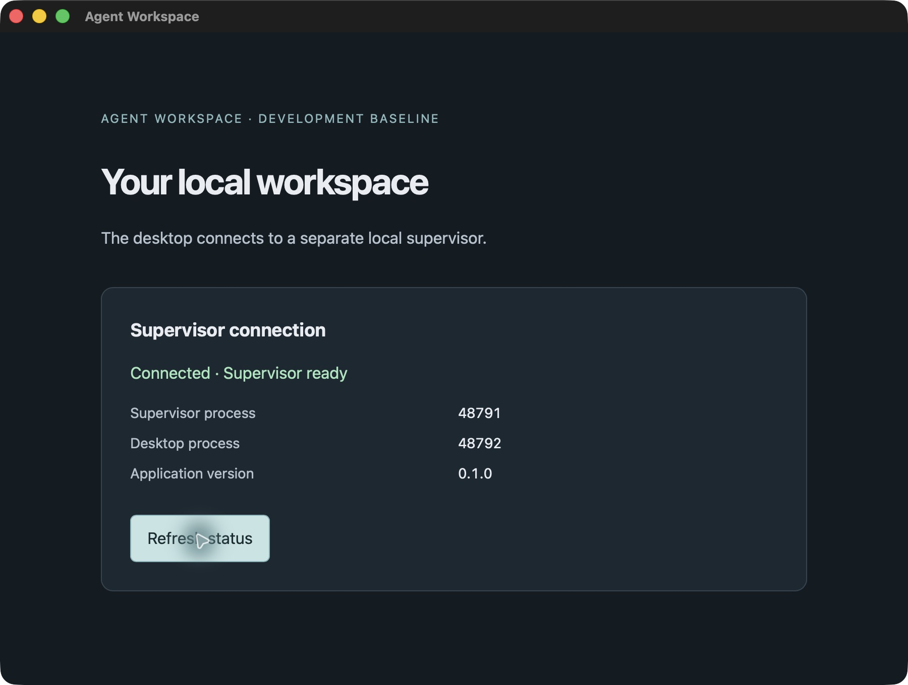

# Milestone 01 · ticket 01 bootstrap evidence

Verified 2026-11-12 on Apple Silicon macOS. Ticket 01 is implemented; the overall
milestone remains incomplete. No provider adapter, agent session, authentication
change, or RAT inspection was performed.

## Source and scope

Starting commit: `f8a882ada3a842e1efb188e01c574983b2775316` on `main`.
The implementation commit containing this evidence records the source cohort.
No scaffold generator was used; files were authored directly. Selected plain
TypeScript with Vite, pnpm, Cargo, and Tauri 2. No frontend framework owns policy.

The desktop uses the same typed `SupervisorClient::status` connection as the
actual-process test. A separately launched supervisor hosts `Core::status`.
The bootstrap launcher provides a private temporary socket endpoint explicitly;
product discovery/reconnect/compatibility and application-state admission remain
ticket 02 work. No repository registration, persistence, or chat is implemented.

## Resolved cohort

| Component            | Version / platform                           |
| -------------------- | -------------------------------------------- |
| Machine              | MacBook Pro Mac16,8, Apple M4 Pro, 48 GB RAM |
| OS / target          | macOS 26.2 (25C56), aarch64-apple-darwin     |
| Command Line Tools   | `/Library/Developer/CommandLineTools`        |
| Rust                 | rustc 1.99.1 (58cf8f9c3, 2026-10-13)         |
| Cargo                | 1.99.1 (5f94df478, 2026-08-27)               |
| Node                 | 26.13.1, installed through fnm               |
| Corepack             | 0.36.0                                       |
| pnpm                 | 12.18.0                                      |
| TypeScript           | 7.0.2                                        |
| Vite                 | 8.3.8                                        |
| Prettier             | 3.10.1                                       |
| Tauri Rust / build   | 2.12.5 / 2.7.4                               |
| Tauri JS API / CLI   | 2.12.4 / 2.12.4                              |
| serde / serde_json   | 1.0.229 / 1.0.154                            |
| tempfile (test only) | 3.27.0                                       |

Resolved stable package versions with `pnpm view <package> version`,
`cargo search`, and `cargo info tauri@2` / `cargo info tauri-build@2` at execution.
Tauri 3.0.0-alpha.6 / build 3.0.0-alpha.4 were excluded as prereleases. Vite's
published Node requirement (`^20.19.0 || >=22.12.0`) includes Node 26.13.1.
Rust's current stable version was checked against the
[official release announcement](https://blog.rust-lang.org/releases/latest/).
The [Tauri config reference](https://v2.tauri.app/reference/config/) and installed
CLI help govern the manual configuration. Cargo.lock and pnpm-lock.yaml retain
the full dependency cohort. pnpm generated a `prettier@3.10.1` release-age
exception in pnpm-workspace.yaml for the selected current stable version.

## Commands and results

Commands ran in this repository. Node commands used the selected Node via
`fnm exec --using=26.13.1` followed by the command below; a normal shell can use
`fnm use` first, as documented in README.md.

| Command / check                                     | Result                                                                                                                                   |
| --------------------------------------------------- | ---------------------------------------------------------------------------------------------------------------------------------------- |
| `fnm install 26.13.1`                               | Passed; selected latest registry stable Node                                                                                             |
| `corepack pnpm install --frozen-lockfile`           | Passed; pinned pnpm 12.18.0, no lockfile changes                                                                                         |
| `cargo test -p workspace-core --test status`        | Red for absent core interface, then passed (1 test)                                                                                      |
| `cargo test -p workspace-supervisor --test startup` | Red for absent connection interface; then exposed non-private temp directory; passed after explicitly making test state private (1 test) |
| `corepack pnpm frontend:build`                      | Passed TypeScript and production Vite build                                                                                              |
| `corepack pnpm check`                               | Passed TypeScript, locked workspace Cargo check, Clippy all targets with warnings denied                                                 |
| `corepack pnpm dev`                                 | Built supervisor, bound socket, started Vite on 127.0.0.1:1420 and ran Tauri debug binary                                                |
| Development launcher SIGTERM                        | Exited 0; both owned PIDs gone and private directory removed                                                                             |
| `corepack pnpm build`                               | Passed; release supervisor and macOS .app bundle built                                                                                   |
| `corepack pnpm start`                               | Opened built .app executable against separate release supervisor; observed successful status in native window                            |
| Release launcher SIGTERM                            | Exited 0; cleanup verified below                                                                                                         |

Final formatting, full-suite, and review results are recorded below after review.

## Observed desktop

The actual bundled Tauri window at `tauri://localhost` displayed
**Connected · Supervisor ready**, application version **0.1.0**, supervisor PID
**48791**, and desktop PID **48792**. Clicking **Refresh status** retained the same
owner PID and successful status. OS process inspection confirmed two separate
executables with the bootstrap launcher as their parent. This is deterministic
application startup evidence, with no provider fixture or native provider work.

Initial failed setup checks, retained for clarity:

- The pre-existing global pnpm 10.12.4 shim failed switching to pnpm 12.18.0
  (`ENOEXEC`). Corepack successfully resolved and executed the pinned native
  pnpm. Development/build hooks use Corepack as well.
- TypeScript initially rejected the CSS import; adding Vite's client type
  declarations resolved it.
- Tauri's context macro initially required a default PNG icon even with an empty
  bundle-icon list; the authored 32×32 RGBA icon resolved it.
- Native computer-use could not bind the unbundled debug executable. The built
  .app was accessible and provided the retained screenshot and interaction check.

## Qualification limits

This ticket establishes build/start/status only. A1–A10 product acceptance,
full desktop fixture workflows, latency targets, and all native Codex scenarios
are **not run** and remain open. No native provider allowance was requested or
used. The development launcher cleanup is not qualification of runtime cleanup,
durable shutdown, desktop crash survival, or supervisor recovery.
